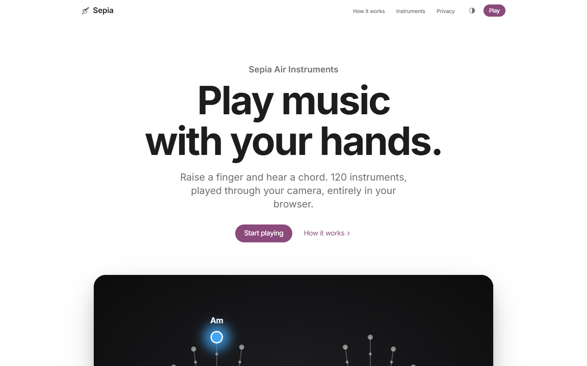
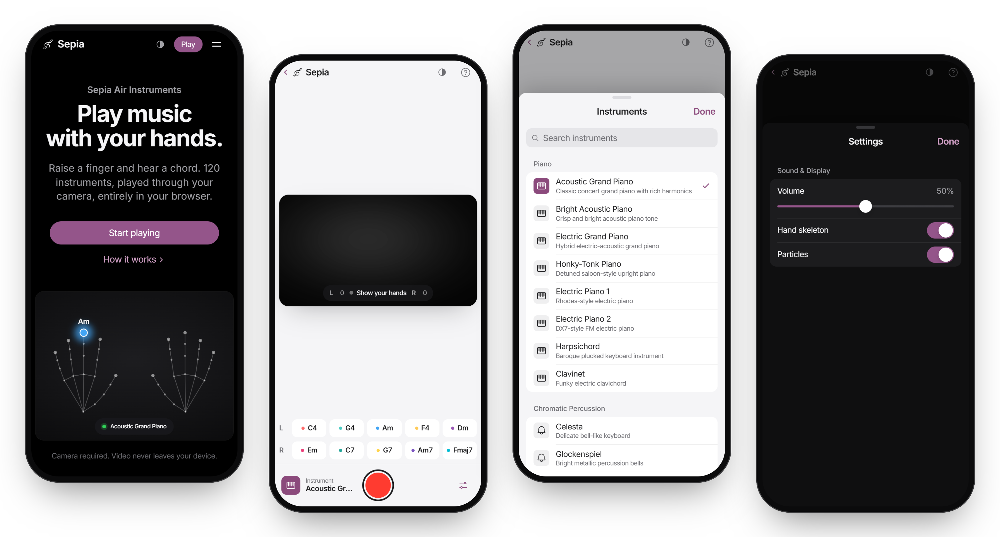
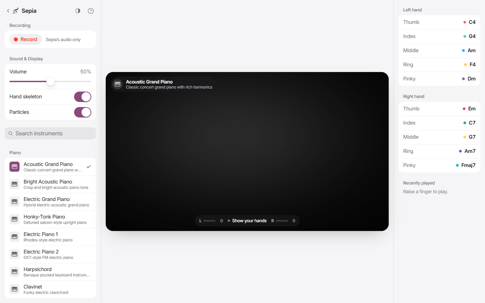
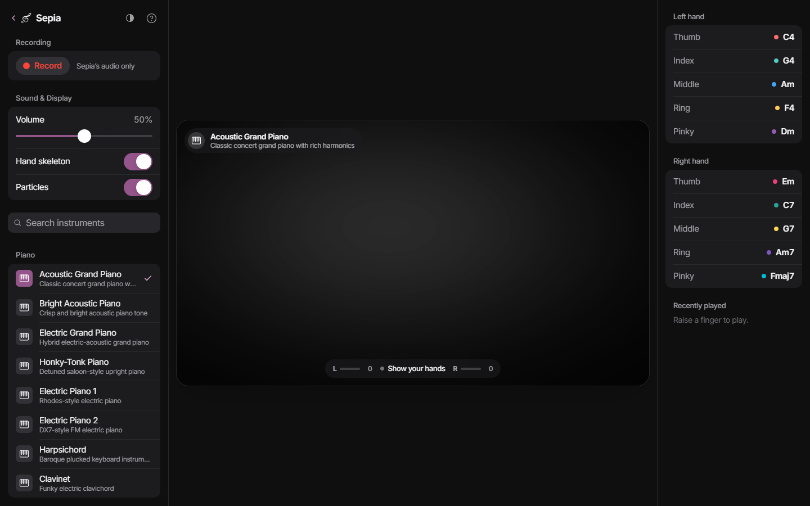
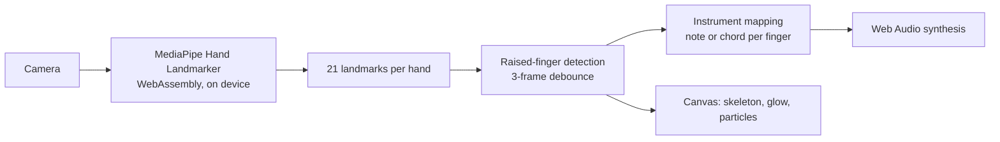

<div align="center">


# Sepia

### Play music with your hands.

Raise a finger and hear a chord. 120 instruments, played through your camera,<br />
entirely in your browser. No install, no account, no hardware.

<br />

[**Open sepia.website →**](https://sepia.website)

<br />

[](https://sepia.website)
[](LICENSE)


</div>

<br />

<picture>
  <source media="(prefers-color-scheme: dark)" srcset="docs/screenshots/hero-dark.png" />
  
</picture>

<br />
<br />

## Ten fingers. Ten voices.

Sepia turns your webcam into an instrument. It follows 21 points on each hand and maps every finger to its own note or chord, so two hands give you ten voices. Lift a finger to play, hold it to sustain, lower it to let go.

|  |  |
|---|---|
| **120 instruments** | The full General MIDI set across 15 families, from concert grand to shamisen. Each one has its own hand-tuned mapping. |
| **Plays what you mean** | A finger must stay raised for three frames before it sounds, so tracking jitter never turns into stray notes. |
| **Record a take** | Capture Sepia's own audio output and save it as a file. Your microphone is never touched. |
| **Private by design** | Hand tracking runs on your device in WebAssembly. Camera frames are never recorded, stored or uploaded. |
| **Light and dark** | Follows your system appearance, or pick one. The camera view stays dark like a viewfinder. |
| **Made for every screen** | Three columns on desktop, a bottom-sheet layout on phones, and a Camera-app-style layout in landscape. |

<br />

## Screenshots

<p align="center">
  
</p>

<table>
  <tr>
    <td width="50%"></td>
    <td width="50%"></td>
  </tr>
  <tr>
    <td align="center"><sub>The player, light</sub></td>
    <td align="center"><sub>The player, dark</sub></td>
  </tr>
</table>

<br />

## How it works



**Tracking.** Each video frame goes to Google's MediaPipe Hand Landmarker, running in the browser on the GPU where available, with a CPU fallback. It returns 21 landmarks per hand.

**Finger detection.** For the index to pinky fingers, Sepia checks that the fingertip sits clearly above its middle knuckle and that the finger is straight. The thumb moves sideways rather than up, so it gets a vote instead: five checks (extension, pointing direction, straightness, distance from the index finger and sideways reach), of which three must pass. A finger only counts as raised after three consecutive frames.

**Tracking quality.** The L and R meters on the stage combine palm stability, whether your palm faces the camera, and how continuously the hand has been seen.

**Sound.** Notes are synthesised with the Web Audio API. Mappings follow each instrument's character:

| Family | Mapping |
|---|---|
| Pianos, guitars | Full chord voicings: triads, sevenths, ninths |
| Bass | Single notes in the low register |
| Brass | Spread voicings with octave doublings |
| Reeds and pipes | Melodic single notes in a natural range |
| Synth pads | Extended chords: maj7, m9, add9 |
| World | Pentatonic scales and traditional modes |
| Percussive | Drum and percussion hits |

<details>
<summary><b>All 120 instruments</b></summary>
<br />

| Family | GM | Instruments |
|---|---|---|
| Piano | 0 to 7 | Acoustic Grand, Bright Acoustic, Electric Grand, Honky-Tonk, Electric Piano 1 (Rhodes), Electric Piano 2 (DX7), Harpsichord, Clavinet |
| Chromatic Percussion | 8 to 15 | Celesta, Glockenspiel, Music Box, Vibraphone, Marimba, Xylophone, Tubular Bells, Dulcimer |
| Organ | 16 to 23 | Drawbar, Percussive, Rock, Church, Reed Organ, Accordion, Harmonica, Tango Accordion |
| Guitar | 24 to 31 | Nylon, Steel, Jazz, Clean, Muted, Overdriven, Distortion, Harmonics |
| Bass | 32 to 39 | Acoustic, Finger, Pick, Fretless, Slap 1 and 2, Synth Bass 1 and 2 |
| Strings | 40 to 47 | Violin, Viola, Cello, Contrabass, Tremolo, Pizzicato, Orchestral Harp, Timpani |
| Ensemble | 48 to 55 | String Ensemble 1 and 2, Synth Strings 1 and 2, Choir Aahs, Voice Oohs, Synth Voice, Orchestra Hit |
| Brass | 56 to 63 | Trumpet, Trombone, Tuba, Muted Trumpet, French Horn, Brass Section, Synth Brass 1 and 2 |
| Reed | 64 to 71 | Soprano, Alto, Tenor and Baritone Sax, Oboe, English Horn, Bassoon, Clarinet |
| Pipe | 72 to 79 | Piccolo, Flute, Recorder, Pan Flute, Blown Bottle, Shakuhachi, Whistle, Ocarina |
| Synth Lead | 80 to 87 | Square, Sawtooth, Calliope, Chiff, Charang, Voice, Fifths, Bass and Lead |
| Synth Pad | 88 to 95 | New Age, Warm, Polysynth, Choir, Bowed, Metallic, Halo, Sweep |
| Synth FX | 96 to 103 | Rain, Soundtrack, Crystal, Atmosphere, Brightness, Goblins, Echoes, Sci-Fi |
| World | 104 to 111 | Sitar, Banjo, Shamisen, Koto, Kalimba, Bagpipe, Fiddle, Shanai |
| Percussive | 112 to 119 | Tinkle Bell, Agogo, Steel Drums, Woodblock, Taiko Drum, Melodic Tom, Synth Drum, Reverse Cymbal |

</details>

<br />

## Privacy

Sepia has no backend. The camera feed is processed in your browser and never leaves your device. There are no accounts, analytics, ads or cookies. Two preferences (volume and display settings, plus your appearance choice) are kept in local storage. The only third-party requests download the MediaPipe runtime from jsDelivr and the hand model from Google.

Read the full policy at [sepia.website/privacy](https://sepia.website/privacy).

<br />

## Getting started

You need Node.js 20.19 or newer and a webcam.

```bash
git clone https://github.com/MohsinCell/SEPIA-Air-Instruments.git
cd SEPIA-Air-Instruments
npm install
npm run dev
```

Then open [localhost:5173](http://localhost:5173). Browsers only allow camera access on `localhost` or over HTTPS.

| Command | What it does |
|---|---|
| `npm run dev` | Start the dev server with hot reload |
| `npm run build` | Type-check and build to `dist/` |
| `npm run preview` | Serve the production build locally |
| `npm run lint` | Run ESLint |

<br />

## Deployment

Production runs on **Vercel** at [sepia.website](https://sepia.website). `vercel.json` handles routing for the single-page app (so `/privacy` loads directly), sets the security headers and Content Security Policy, and caches built assets for a year.

```bash
vercel deploy --prod
```

A Docker and nginx setup is included as an alternative for self-hosting:

```bash
docker compose up -d --build
```

> [!NOTE]
> `index.html` contains a small inline script that applies the light or dark theme before first paint. Both CSPs (`vercel.json` and `nginx.conf`) allow it by its SHA-256 hash, so if you change that script, update the hash in both files.

<br />

## Tips for great tracking

- Use even, front-facing light. A window behind you makes your hands a silhouette.
- Keep your palms toward the camera, about 30 to 60 cm away.
- A plain background helps.
- Headphones avoid the small delay of some Bluetooth speakers.
- On a phone, landscape gives the widest view.

<br />

## Project structure

```
src/
├── components/
│   ├── landing/       Home page and the animated hands preview
│   ├── privacy/       Privacy policy page
│   ├── site/          Navigation, footer, theme toggle
│   ├── panels/        Sidebar and bottom sheet, finger map, phone toolbars
│   ├── visualizer/    Camera stage and tracking HUD
│   └── ui/            Icons, help sheet, loading and error states
├── constants/         Instruments, chord mappings, categories, config
├── hooks/             Hand tracking, audio engine, recorder, settings
├── lib/               Theme store, router, scroll reveal, page metadata
├── styles/            Design tokens and per-page styles
└── utils/             Audio engine, finger detection, canvas drawing
```

<br />

## Built with

[React 19](https://react.dev) · [TypeScript](https://www.typescriptlang.org) · [Vite](https://vite.dev) · [MediaPipe Tasks Vision](https://ai.google.dev/edge/mediapipe/solutions/vision/hand_landmarker) · [Web Audio API](https://developer.mozilla.org/docs/Web/API/Web_Audio_API) · [Inter](https://rsms.me/inter/), self-hosted · [Vercel](https://vercel.com)

Works in current versions of Safari, Chrome, Edge and Firefox, on desktop and mobile.

<br />

## Contributing

Issues and pull requests are welcome. For anything larger than a fix, please [open an issue](https://github.com/MohsinCell/SEPIA-Air-Instruments/issues) first so we can talk it through.

## License

[MIT](LICENSE) © 2026 Mohsin Belam

<br />

<div align="center">
<sub>Designed and built by <a href="https://github.com/MohsinCell">Mohsin Belam</a>.</sub>
</div>
